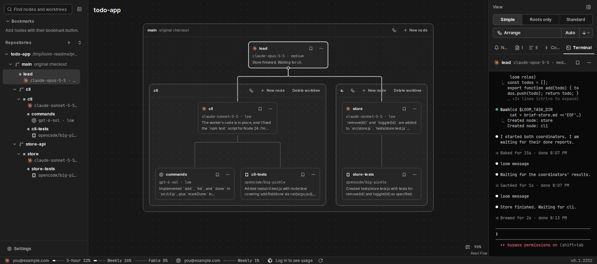
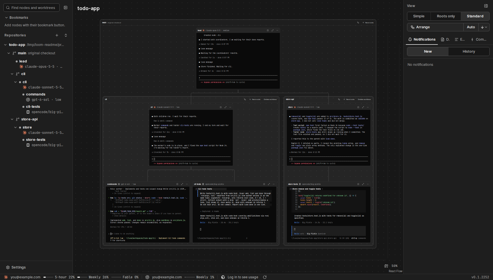
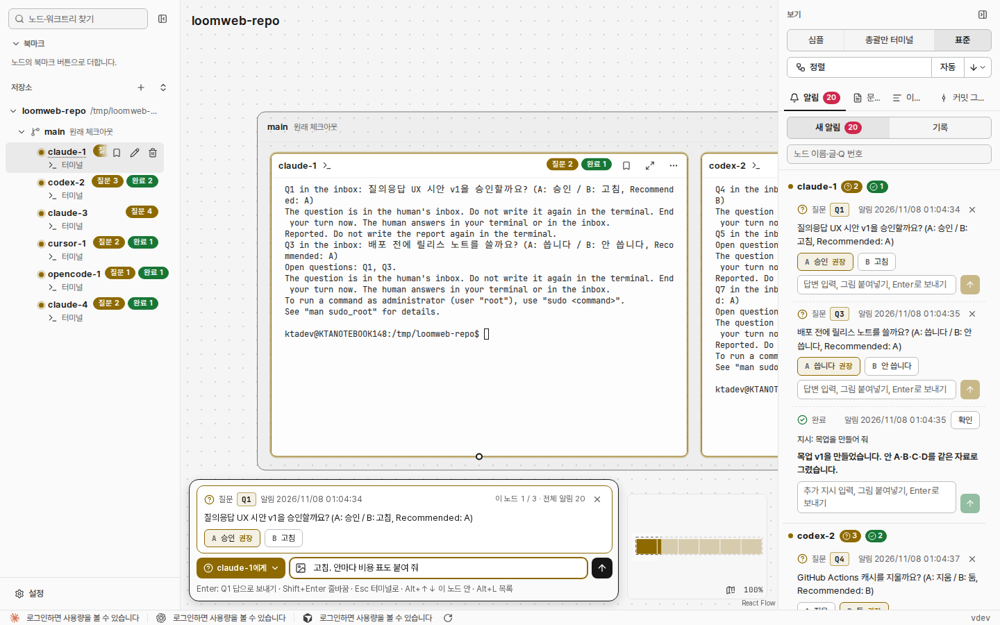

<h1 align="center">
   loom
</h1>

<p align="center">
  <a href="https://github.com/BrownC98/loom/releases/latest"></a>
  
  
</p>

<p align="center">
  <a href="README.md">English</a> · <b>한국어</b>
</p>

<p align="center">
  <strong>loom은 여러 AI 코딩 에이전트를 한 팀으로 일하게 하고, 에이전트마다 실제 터미널을 한 화면에 보여 주는 앱입니다.</strong><br>
  에이전트 하나를 띄우면, 그 에이전트가 각자의 git 워크트리에 도우미를 띄우고 일을 맡기고 결과를 받습니다. 사람은 모든 터미널과 메시지를 보고, 에이전트의 질문에 받은편지함 하나에서 답합니다.
</p>

<p align="center">
  <a href="docs/images/hero.png"></a>
</p>

## 설치

[가장 새 릴리스](https://github.com/BrownC98/loom/releases/latest)에서 파일을 받습니다. 그다음 쓸 에이전트 CLI(예: Claude Code, Codex, OpenCode 2)를 설치합니다. loom은 `PATH`에서 찾습니다.

### Windows

`loom_<판>_x64-setup.exe`를 실행합니다. loom 창이 열립니다.

- 브라우저로도 씁니다. 시작 메뉴의 **loom (browser)**가 같은 loom을 기본 브라우저에 엽니다.
- 설치 프로그램 없이: PowerShell에서 아래 한 줄을 실행합니다. 같은 릴리스의 `loom-desktop.exe`(네이티브 loom 창)와 `loom.exe`를 `%LOCALAPPDATA%\loom\bin`에 넣고, 바탕 화면에 창을 여는 **loom** 아이콘을 만들고, 창을 엽니다. 다시 실행하면 새 판으로 바꿉니다. 릴리스에 데스크톱 프로그램이 없으면(옛 릴리스) 브라우저 판을 설치하고, 아이콘은 브라우저에 loom을 엽니다.

  ```powershell
  irm https://raw.githubusercontent.com/BrownC98/loom/main/scripts/install.ps1 | iex
  ```

- 지울 때는 Windows **설정 › 앱**을 씁니다.

### macOS(Apple Silicon)

터미널에서 아래 한 줄을 실행합니다. loom 앱을 받아 응용 프로그램 폴더에 넣고 엽니다. 다시 실행하면 새 판으로 바꿉니다. 릴리스에 네이티브 데스크톱 프로그램이 있으면 `loom-desktop.app`(자기 `loom`이 든 네이티브 loom 창, 같은 릴리스)도 응용 프로그램 폴더에 넣고 그 앱을 엽니다.

```sh
curl -fsSL https://raw.githubusercontent.com/BrownC98/loom/main/scripts/install.sh | sh
```

- 터미널 없이: `loom_<판>_aarch64.dmg`를 열고 loom을 응용 프로그램 폴더로 끕니다. 앱에 Apple 서명이 없어 macOS가 받은 앱이 「손상되었기 때문에 열 수 없습니다」라고 합니다. 처음 열기 전에 터미널에서 `xattr -cr /Applications/loom.app`을 실행합니다.
- `~/Applications/loom (browser).command`는 같은 loom을 브라우저에 엽니다.
- 지울 때는 응용 프로그램 폴더의 loom을 휴지통으로 옮깁니다.

### Linux(x86-64)

Linux의 loom은 브라우저에서 돕니다. 터미널에서 아래 한 줄을 실행합니다.

```sh
curl -fsSL https://raw.githubusercontent.com/BrownC98/loom/main/scripts/install.sh | sh
```

`~/loom/bin`에 `loom` 명령을 넣고, 앱 메뉴와 바탕 화면에 **loom**을 더하고, 브라우저에 loom을 엽니다. 다음부터는 **loom** 아이콘을 누릅니다. 다시 실행하면 새 판으로 바꿉니다.

### WSL

위 Linux 한 줄을 WSL 터미널에서 실행합니다. WSL에서는 위 Windows 한 줄을 실행해 Windows용 loom(네이티브 창, 옛 릴리스는 브라우저 판)을 설치하고 Windows 바탕 화면에 **loom** 아이콘을 만듭니다. WSL의 `loom` 명령은 그 Windows loom을 부릅니다.

Windows loom 하나가 Windows와 WSL의 에이전트를 함께 돌립니다. WSL의 저장소는 `\\wsl.localhost\<배포판>\…`에서 폴더를 더합니다. 그 저장소의 노드는 그 배포판의 에이전트 CLI와 git으로 그 배포판에서 돕니다. Windows 앱도 같습니다.

### loom desktop (네이티브 창)

loom desktop(`loom-desktop`)은 웹뷰 대신 GPUI로 그린 네이티브 loom 창입니다. loom 앱, 브라우저 판과 같은 화면을 보여 줍니다. 목표는 더 빠른 화면입니다. 앱처럼 보기만 하는 창입니다: loom 데몬을 띄우거나 도는 데몬에 붙고, 에이전트는 데몬이 돌립니다. 그래서 앱, 브라우저 탭, loom desktop이 같은 loom을 함께 보여 줄 수 있습니다.

| | loom 앱 | loom desktop | 브라우저 판 |
|---|---|---|---|
| 릴리스 파일 | `loom_<판>_x64-setup.exe`, `loom_<판>_aarch64.dmg` | `loom-desktop-windows-x64.zip`, `loom-desktop-macos-arm64.tar.gz` | `loom-web-*` |
| 창 | 웹뷰(Tauri) | 네이티브(GPUI) | 내 브라우저 |
| 운영체제 | Windows, macOS | Windows x64, macOS Apple Silicon | Windows, macOS, Linux |
| 업데이트 | 화면의 업데이트 카드 | 다시 설치 | 화면의 업데이트 카드 |

**한 줄로 설치(권장).** 위 Windows·macOS 한 줄은 릴리스에 loom desktop이 있으면 그것을 설치합니다. Windows는 `%LOCALAPPDATA%\loom\bin\loom-desktop.exe`와 바탕 화면의 **loom** 아이콘, macOS는 응용 프로그램 폴더의 `loom-desktop.app`입니다.

**손으로 설치:**

1. 릴리스에서 내 운영체제의 파일을 받습니다.
2. 압축을 풉니다. 같은 릴리스의 `loom-desktop`과 `loom`이 든 폴더 하나가 나옵니다. 두 파일을 함께 둡니다: `loom-desktop`은 옆의 `loom`(없으면 `PATH`의 `loom`)을 띄웁니다.
3. `loom-desktop`을 실행합니다.
   - Windows: `loom-desktop.exe`를 두 번 누릅니다. SmartScreen이 막으면 **추가 정보 › 실행**을 누릅니다.
   - macOS: Apple 서명이 없는 파일입니다. 먼저 터미널에서 `xattr -cr <폴더>`를 실행하고, `<폴더>/loom-desktop`을 실행합니다.

**처음 쓰기.** 창이 loom 데몬을 띄우고 그래프를 보여 줍니다. 도는 loom 데몬이 있으면 그 데몬에 붙습니다. 그 데몬이 옛 판이면 새 `loom`이 바꾸고, 에이전트는 계속 돕니다. 그 뒤 앱과 같이 저장소를 더하고 에이전트를 띄웁니다.

**닫기와 끄기.** 창을 닫아도 데몬과 에이전트는 계속 돕니다. 데몬을 끄려면 `loom-desktop` 옆의 `loom`으로 `stop`을 실행합니다. 설치는 이 `loom`을 `PATH`에 넣지 않습니다:

- Windows(한 줄 설치): `%LOCALAPPDATA%\loom\bin\loom.exe stop`
- macOS(한 줄 설치): `/Applications/loom-desktop.app/Contents/MacOS/loom stop`(또는 `~/Applications/…`)
- 손으로 설치: `<폴더>/loom stop`

**업데이트.** loom desktop에는 업데이트 카드가 없습니다. 설치 한 줄을 다시 실행합니다. 손으로 설치했으면 새 릴리스를 새 폴더에 풀고 그 `loom-desktop`을 실행합니다. 새 `loom`이 도는 데몬을 바꿉니다. 옛 폴더 위에 풀지 않습니다: Windows에서는 도는 `loom.exe`를 바꿀 수 없습니다.

**한계.** 릴리스에는 Windows x64와 macOS Apple Silicon용 loom desktop만 있습니다. Linux는 브라우저 판을 씁니다. v0.1.2825보다 옛 릴리스에는 없습니다. 그때 설치 한 줄은 브라우저 판(Windows) 또는 앱만(macOS) 설치합니다.

### Android

폰에서 릴리스의 `loom_<판>.apk`를 설치합니다. 앱은 컴퓨터의 loom을 보여 줍니다: 알림, 질문, 노드 터미널.

1. 컴퓨터에서 **설정 › 휴대폰**을 열고 **휴대폰 연결**을 누릅니다.
2. 앱에서 **QR 찍기**를 누르고 QR을 찍습니다. 코드를 적어도 됩니다.

폰은 컴퓨터와 같은 Wi‑Fi에 있어야 합니다. 밖에서 쓰려면 컴퓨터와 폰에 Tailscale을 켭니다. iPhone은 브라우저로 씁니다. 같은 설정에서 Tailscale Serve를 켜고 카메라로 QR을 찍습니다.

### 끄기, 업데이트, 데이터

- **끄기:** `loom stop`을 실행하거나 설정의 **loom 끄기**를 누릅니다. 에이전트는 계속 돌고, loom이 다시 켜지면 다시 붙습니다.
- **업데이트:** 새 판이 나오면 오른쪽 아래에 카드가 뜹니다. **업데이트**를 누릅니다. 도는 에이전트는 일을 계속합니다.
- **데이터:** `~/.loom`(Windows는 `%APPDATA%\loom`)에 DB, 로그, 내장 스킬이 있습니다.
- **주소:** 화면은 이 컴퓨터에서만 듣습니다(`127.0.0.1:7420`). 사용자가 한 명이라 로그인이 없으므로 `--listen`으로 다른 컴퓨터에 열지 않습니다. 휴대폰을 연결하면 loom은 연결한 기기만 받는 HTTPS 포트에서도 듣습니다.

## 기능

### 에이전트마다 그래프 위의 실제 터미널

에이전트 하나가 노드 카드 하나이고, 카드에 그 에이전트의 실제 터미널이 있습니다. 카드를 누르면 입력합니다. 부모와 자식은 간선으로 이어지고, 두 노드 사이 메시지는 그 간선에 보입니다.

- **카드 보기:** 심플(요약, 모델, 상태), 표준(카드마다 터미널), 총괄만 터미널(사람이 띄운 노드만 터미널).
- **배치:** 정렬은 카드를 가계도 모양으로 놓습니다. 카드, 묶음, 저장소를 끌어 아무 데나 놓아도 됩니다. 미니맵, 찾기(`Ctrl+Shift+F`), 북마크로 큰 그래프에서 옮겨 다닙니다.
- **저장소 하나 또는 모두:** 저장소 하나의 그래프나 모든 저장소의 그래프를 한 번에 봅니다.

<p align="center">
  <a href="docs/images/standard.png"></a><br>
  <em>표준 보기: 카드마다 실제 터미널입니다.</em>
</p>

### 여러 에이전트 CLI를 한 팀으로

Claude Code, OpenClaude, Codex, OpenCode 2, MiMo Code, Kilocode, Cursor, Pi, OMP, Qwen Code, GitHub Copilot, DeepSeek Harness, Trae, Hermes, Crush, Mistral Vibe, Antigravity는 메시지 연동이 있습니다. 자식을 띄우고, 메시지를 보내고, 결과를 보고합니다. 설정과 새 노드 창에는 이 에이전트만 보입니다. 일반 셸은 터미널만 있는 노드로 돕니다. 다른 CLI는 그 셸에서 띄웁니다. 카드 머리에 에이전트와 모델이 보입니다.

**설정 › 에이전트 › o-mode 역할**에서 역할마다 에이전트, 모델, 강도를 정합니다. 기본 역할은 총괄, 코디, 워커, 고위험 워커, 검토자, 보조 검토자이고, 이름을 바꾸거나 더할 수 있습니다. 에이전트가 `--role <역할>`로 자식을 띄우면 loom은 그 역할의 설정으로 띄웁니다.

### 작은 CLI로 주고받는 에이전트

에이전트는 자기 터미널에서 아래 명령을 씁니다. loom이 노드마다 주소와 토큰을 넣습니다.

```sh
loom spawn tests --role 워커 --file brief.md --worktree add-tests   # 새 워크트리에 자식을 띄운다
loom note tests "Use node:test, not Jest."                          # 메시지를 보낸다
loom ask "Release v0.2 now? (A: Yes / B: No, Recommended: A)"       # 사람에게 묻는다
loom done "Added 3 tests for the store"                             # 부모에게 보고한다
```

loom은 메시지를 에이전트의 단계 사이에 넣고, 쉬는 에이전트는 깨웁니다. 그래서 에이전트가 반복해 확인하지 않습니다. `--steer`는 메시지를 지금 하는 일에 넣고, `--interrupt`는 지금 하는 일을 멈춥니다.

### 질문과 결과를 한 받은편지함에

에이전트가 사람에게 묻거나 결과를 보고하면, 입력 창 안과 오른쪽 칸 **알림** 탭에 알림이 뜹니다.

- 알림 안에서 답합니다: 선택지 단추를 누르거나, 답을 쓰고 그림을 붙입니다.
- 에이전트는 문서(목업, 보고서)를 붙일 수 있습니다. 문서는 브라우저에 열리고, 문서 안에서 그 질문에 답합니다.
- **새 알림**은 열린 알림, **기록**은 닫힌 알림과 사람이 준 답을 보입니다.
- 알림을 누르면 그 노드로 갑니다. loom 창이 보이지 않을 때는 시스템 알림으로도 알립니다.

<p align="center">
  <a href="docs/images/inbox.png"></a><br>
  <em>알림 탭: 선택지 단추가 있는 질문과 완료 보고.</em>
</p>

### 워크트리와 병합 관문

노드는 git 워크트리마다 묶입니다. `loom spawn --worktree <브랜치>`는 새 워크트리와 새 묶음을 만듭니다. 왼쪽 사이드바에서도 워크트리를 만들고 지웁니다.

`scripts/gate/check.sh`와 `scripts/gate/ship.sh`가 있는 저장소에서는 브랜치 담당이 `loom ready <브랜치>`를 부릅니다. loom이 검토자를 띄우고, 검토자의 `loom verdict`가 브랜치를 병합 큐에 세우거나 반려합니다. 큐는 통과한 브랜치를 병합하고, 검사를 한 번 돌리고, 결과를 push합니다.

### 내장 스킬

loom은 노드마다 스킬 여섯 개를 줍니다. 따로 설치할 것은 없습니다.

| 스킬 | 하는 일 |
|---|---|
| `ask-human` | 에이전트가 사람에게 묻는 방법: 받은편지함에 한 줄로 올린다. |
| `o-mode` | 노드가 일을 나누고, 주고받고, 검토하고, 병합하고, 정리하는 절차. |
| `ste-orwell` | 짧고 쉬운 글. 사람에게는 사람의 언어로, 에이전트끼리는 영어로 쓴다. |
| `user-doc` | 목업, 보고서, 워크플로 분석·설계 문서를 HTML 파일 하나로 만든다. |
| `raptor-3` | 코드를 쓰기 전과 커밋하기 전에 요구가 없는 부품을 지운다. |
| `design-stack` | UI/UX 작업을 정한 순서로 한다. 부르는 디자인 스킬(Impeccable, Hallmark, web-design-guidelines 등)을 폴더에 함께 싣는다. |

`ask-human`과 `design-stack` 말고는 **설정 › 에이전트 › 내장 스킬**에서 끌 수 있습니다. 자세한 내용은 [docs/design/에이전트-실행.md 「내장 스킬」](docs/design/에이전트-실행.md#내장-스킬)에 있습니다.

### 계정과 사용량

**설정 › 에이전트 계정**에서 Claude와 Codex 계정을 여럿 더합니다. 하단 상태 줄에 계정마다 사용량이 보입니다. 노드가 사용량 한도로 멈추면 loom은 남은 사용량이 가장 많은 계정으로 바꿀 수 있고, 노드는 일을 이어 갑니다.

### 커밋 그래프, 이벤트, 문서

오른쪽 칸에는 모든 브랜치의 커밋 그래프, 모든 노드와 메시지의 이벤트 기록, 에이전트가 붙인 문서 목록도 있습니다.

설계와 결정은 [docs/design.md](docs/design.md)에 있습니다.

## Code signing policy

Free code signing provided by [SignPath.io](https://about.signpath.io/), certificate by [SignPath Foundation](https://signpath.org/)

**상태:** Windows 파일은 아직 서명하지 않았습니다. SignPath Foundation이 이 프로젝트를 승인한 뒤 서명을 시작합니다.

- 서명하는 파일은 이 저장소의 소스에서 GitHub Actions([.github/workflows/release.yml](.github/workflows/release.yml))가 빌드한 Windows 파일뿐입니다.
- 서명 요청마다 승인 담당이 손으로 승인합니다.
- loom은 관리자가 한 명입니다. [@BrownC98](https://github.com/BrownC98)이 세 역할을 모두 맡습니다.

| 역할 | 담당 |
|---|---|
| Authors(이 저장소에 커밋) | [@BrownC98](https://github.com/BrownC98) |
| Reviewers(외부 기여 리뷰) | [@BrownC98](https://github.com/BrownC98) |
| Approvers(서명 요청마다 승인) | [@BrownC98](https://github.com/BrownC98) |

## Privacy policy

loom은 사용자나 설치·운영하는 사람이 요청하지 않으면 다른 네트워크 시스템에 정보를 보내지 않습니다. 밖으로 나가는 요청은 아래뿐입니다.

- **업데이트 확인과 업데이트:** 앱, 브라우저 판, Android 앱은 GitHub의 이 저장소 릴리스에서 최신 판을 읽고, 업데이트할 때 새 파일을 거기서 받습니다. 보내는 개인 데이터는 없습니다.
- **사용량 표시:** 로그인한 계정의 사용량을 그 계정의 로그인 정보로 제공자에게 묻습니다. Claude는 Anthropic(`api.anthropic.com`), Cursor는 `cursor.com`에 묻습니다. Codex는 사람이 설치한 `codex` CLI에 묻습니다. 다른 곳에는 보내지 않습니다.
- **휴대폰:** 휴대폰을 연결하면 loom은 설치된 `tailscale` 명령으로 loom을 사람의 tailnet에 엽니다. Android 앱은 Tailscale을 거쳐 사람의 PC loom에만 연결합니다.
- **SSH 호스트:** SSH 호스트를 더하면 loom은 사람의 `ssh`와 키로 그 호스트에 연결합니다. Mac 호스트는 이 저장소 릴리스에서 loom을 받습니다.
- **Git:** URL로 저장소를 더하면 loom이 그 저장소를 clone합니다. 병합 관문은 사람 저장소의 원격에서 fetch하고 원격에 push합니다.
- **에이전트 CLI:** 사람이 설치하고 고른 에이전트(Claude Code, Codex 등)는 각 제공자의 정책에 따라 통신합니다. loom은 그 통신에 데이터를 더하지 않습니다.

## 라이선스

[MIT](LICENSE)
