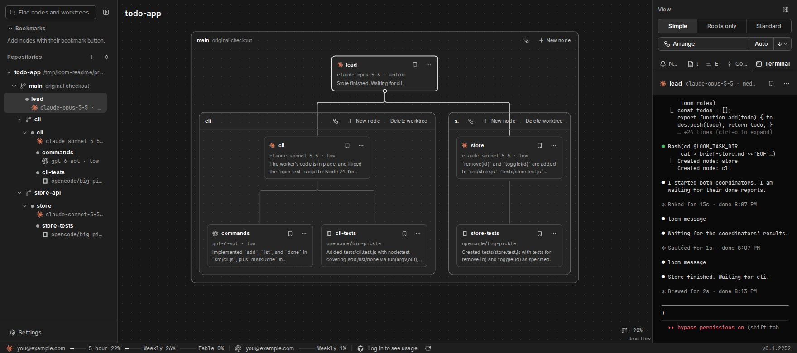
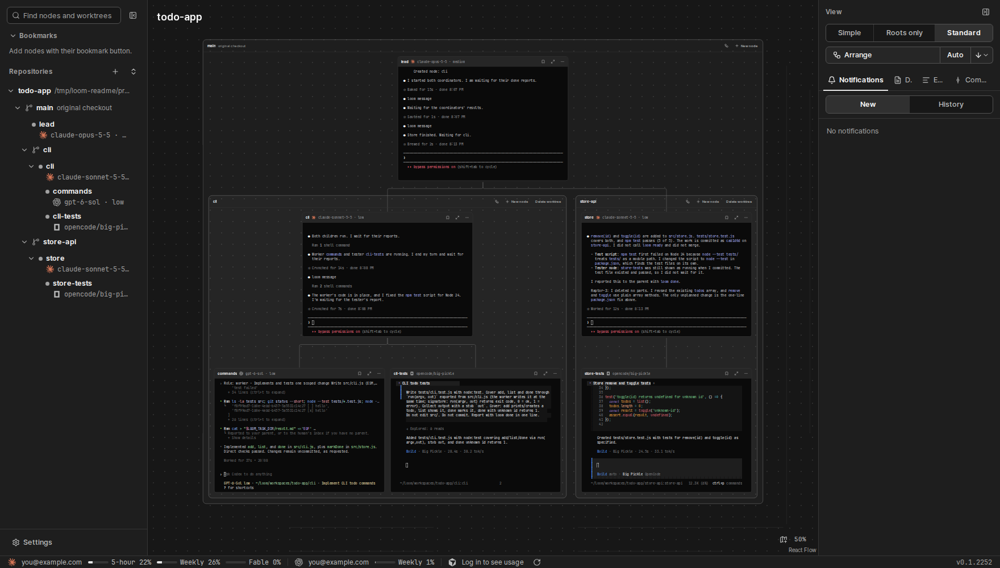
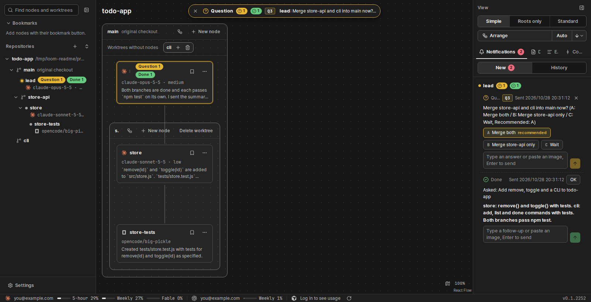

<h1 align="center">
   loom
</h1>

<p align="center">
  <a href="https://github.com/BrownC98/loom/releases/latest"></a>
  
  
</p>

<p align="center">
  <b>English</b> · <a href="README.ko.md">한국어</a>
</p>

<p align="center">
  <strong>loom lets several AI coding agents work as one team, and shows each agent as a live terminal on one screen.</strong><br>
  You start one agent. It starts helpers in their own git worktrees, sends them work and gets their results. You see every terminal and every message, and you answer the agents' questions in one inbox.
</p>

<p align="center">
  <a href="docs/images/hero.png"></a>
</p>

## Install

Get the files from the [latest release](https://github.com/BrownC98/loom/releases/latest). Then install the agent CLIs that you want to use (for example Claude Code, Codex or OpenCode 2). loom finds them on `PATH`.

### Windows

Run `loom_<version>_x64-setup.exe`. The loom window opens.

- loom also works in a browser: **loom (browser)** in the Start menu opens the same loom in your default browser.
- Without the app (browser only): run this line in PowerShell. It puts a **loom** icon on the desktop and opens loom in the browser.

  ```powershell
  irm https://raw.githubusercontent.com/BrownC98/loom/main/scripts/install.ps1 | iex
  ```

- To remove loom, use Windows **Settings › Apps**.

### macOS (Apple Silicon)

Run this line in Terminal. It downloads the loom app, puts it in the Applications folder and opens it. Run it again to update.

```sh
curl -fsSL https://raw.githubusercontent.com/BrownC98/loom/main/scripts/install.sh | sh
```

- Without Terminal: open `loom_<version>_aarch64.dmg` and drag loom to the Applications folder. The app has no Apple signature, so macOS says that the downloaded app "is damaged". Before you open it the first time, run `xattr -cr /Applications/loom.app` in Terminal.
- `~/Applications/loom (browser).command` opens the same loom in your browser.
- To remove loom, move it from the Applications folder to the Trash.

### Linux (x86-64)

loom on Linux runs in your browser. Run this line in a terminal:

```sh
curl -fsSL https://raw.githubusercontent.com/BrownC98/loom/main/scripts/install.sh | sh
```

It puts the `loom` command in `~/loom/bin`, adds **loom** to the app menu and the desktop, and opens loom in the browser. After that, click the **loom** icon. Run the line again to update.

### WSL

Run the Linux line above in a WSL terminal. In WSL, it installs loom for Windows (browser version) and puts a **loom** icon on the Windows desktop. The `loom` command in WSL calls that Windows loom.

One Windows loom runs agents on Windows and in WSL. To work on a repository in WSL, add its folder from `\\wsl.localhost\<distro>\…`. The nodes of that repository run in that distro, with the agent CLIs and the git of that distro. The Windows app does the same.

### Android

Install `loom_<version>.apk` from the release on your phone. The app shows the loom of your computer: notifications, questions and node terminals.

1. On the computer, open **Settings › Phone** and click **Connect phone**.
2. In the app, tap **Scan QR** and scan the QR code. Or type the code.

The phone must be on the same Wi‑Fi as the computer. To use it outside, turn on Tailscale on the computer and the phone. On an iPhone, use loom in the browser: turn on Tailscale Serve in the same settings and scan the QR code with the camera.

### Stop, update and data

- **Stop:** run `loom stop`, or click **Stop loom** in Settings. The agents continue to run, and loom connects to them again when it starts.
- **Update:** when a new version is out, a card shows at the bottom right. Click **Update**. Running agents continue their work.
- **Data:** `~/.loom` (`%APPDATA%\loom` on Windows) holds the database, logs and built-in skills.
- **Address:** the screen listens only on this computer (`127.0.0.1:7420`). It has one user and no sign-in, so do not open it to other computers with `--listen`. After you connect a phone, loom also listens on a separate HTTPS port that accepts only the connected devices.

## Features

### Each agent is a live terminal on a graph

Each agent is a node card with its real terminal. Click a card to type into it. Parents connect to their children, and each message between two nodes shows on the edge between them.

- **Card views:** Simple (summary, model and state), Standard (terminal in each card) and Roots only (terminal only for the nodes that you started).
- **Layout:** Arrange puts the cards in a family tree. You can also drag cards, groups and repositories to any place. The minimap, Find (`Ctrl+Shift+F`) and bookmarks help you move in a large graph.
- **One or all repositories:** show the graph of one repository, or of all repositories at once.

<p align="center">
  <a href="docs/images/standard.png"></a><br>
  <em>Standard view: each card is a live terminal.</em>
</p>

### Many agent CLIs in one team

Claude Code, Codex, OpenCode 2, Cursor, Pi, OMP, DeepSeek Harness and Antigravity have a message link: they can start children, send messages and report results. Settings and the new-node dialog show only these agents. A plain shell runs as a terminal-only node; start other CLIs from it. Each card head shows the agent and the model.

In **Settings › Agents › o-mode roles**, you give each role an agent, a model and an effort. The default roles are 총괄 (lead), 코디 (coordinator), 워커 (worker), 고위험 워커 (high-risk worker), 검토자 (reviewer) and 보조 검토자 (second reviewer), and you can rename them or add more. An agent starts a child with `--role <role>`, and loom starts it with the settings of that role.

### Agents talk with a small CLI

An agent runs these commands in its own terminal. loom gives each node its address and token.

```sh
loom spawn tests --role 워커 --file brief.md --worktree add-tests   # start a child in a new worktree
loom note tests "Use node:test, not Jest."                          # send a message
loom ask "Release v0.2 now? (A: Yes / B: No, Recommended: A)"       # ask the human
loom done "Added 3 tests for the store"                             # report to the parent
```

loom hands each message to the agent between its steps, and wakes an agent that is idle. So agents do not poll. `--steer` puts a message into the current work, and `--interrupt` stops the current work.

### One inbox for questions and results

When an agent asks you a question or reports a result, a notice shows in the question pill at the top of the graph and in the **Notifications** tab of the right panel.

- Answer in the notice: click an option button, or type an answer and paste images.
- An agent can attach a document (a mockup or a report). It opens in the browser, and you answer its question in the document.
- **New** shows open notices. **History** shows closed notices with the answer that you gave.
- Click a notice to go to its node. System notifications can tell you when the loom window is not visible.

<p align="center">
  <a href="docs/images/inbox.png"></a><br>
  <em>The Notifications tab: a question with option buttons and a done report.</em>
</p>

### Worktrees and a merge gate

Nodes are grouped by git worktree. `loom spawn --worktree <branch>` makes a new worktree and a new group. You can also make and delete worktrees in the left sidebar.

The owner of a branch runs `loom ready <branch>`. loom starts reviewers, and their `loom verdict` sends the branch to the merge queue or back for rework. The queue merges the passed branches, runs `scripts/gate/check.sh` once if the repository has it, and pushes the result. If the repository has `scripts/gate/ship.sh`, loom runs it after the push to confirm the deploy. `loom ready <branch> --no-deploy` puts `[skip ci]` in the branch's merge commit into the original checkout, so the remote CI and its deploy do not run; the queue does not batch it with branches that deploy. Into a coordinator branch the flag does nothing: the coordinator gives it on its own `loom ready`.

### Built-in skills

loom gives each node five skills. You do not install anything.

| Skill | What it does |
|---|---|
| `ask-human` | How an agent asks you: one line in the inbox. |
| `o-mode` | How nodes assign work, talk, review, merge and clean up. |
| `ste-orwell` | Short, simple text. Agents write to you in your language and to each other in English. |
| `user-doc` | Mockups and reports as one HTML file. |
| `raptor-3` | Remove parts that have no requirement, before writing code and before each commit. |

You can turn off all but `ask-human` in **Settings › Agents › Built-in skills**. Details (Korean): [docs/design/에이전트-실행.md 「내장 스킬」](docs/design/에이전트-실행.md#내장-스킬).

### Accounts and usage

Add more than one Claude or Codex account in **Settings › Agent accounts**. The status bar shows the usage of each account. When a node stops on a rate limit, loom can switch to the account with the most usage left, and the node continues its work.

### Commit graph, events and documents

The right panel also has the commit graph of all branches, the event log of all nodes and messages, and the list of documents that agents attached.

Design and decisions (Korean): [docs/design.md](docs/design.md).

## Privacy policy

loom sends no data to a place that you did not choose. These are the only requests that go out:

- **Update check:** loom reads `latest.json` from the releases of this repository on GitHub. It sends no personal data.
- **Usage display:** for a Claude account that you signed in to in loom settings, loom asks Anthropic (`api.anthropic.com`) for the usage of that account, with the token of that account. It sends this to no other place.
- **Agent CLIs:** the agents that you install and choose (Claude Code, Codex and others) communicate under the policy of each provider. loom adds no data to that communication.

## License

[MIT](LICENSE)
